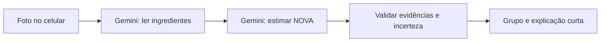

# Arquitetura simplificada

O monorepo mantém Expo/React Native/TypeScript strict, Fastify e um pacote compartilhado. O app possui somente início, captura e resultado. A extração é uma operação interna, sem transcrição exposta ou correção manual. Não há persistência de dados pessoais ou acesso ao SecureStore.

`POST /api/extract` aceita uma foto JPEG/PNG base64 de até 4 MB e devolve nome, ingredientes e qualidade da leitura. `POST /api/analyze` recebe apenas o rótulo e devolve a classificação, evidências e recomendação fixa do Guia. `GET /health` e `GET /api/nova-groups` completam a API. O endpoint de chat foi removido.

A IA pode classificar formulações além do vocabulário local, desde que apresente evidência literal. Isso valida o vínculo textual, não a correção científica da inferência. Leitura incompleta, evidência inventada, abstenção do modelo e conflitos com regras conhecidas produzem indeterminado. A recomendação do Guia acompanha o grupo final, nunca uma recomendação livre do modelo.

Limites: uma foto, body de 6 MB incluindo base64, 20 requisições/minuto/IP e quatro operações simultâneas por instância. Assinaturas JPEG/PNG são verificadas, sem decodificação completa do arquivo. SDK com timeout de 25s, sem retries; cliente com 35s por operação. Extração e classificação são chamadas separadas. Não há banco remoto, histórico ou log de imagens.

O modo demo usa apenas fixtures e regras locais. O modo real falha explicitamente se a IA estiver indisponível. O backend e o aplicativo precisam de endereços acessíveis pelo celular; um túnel para o Metro não encaminha automaticamente a API.
