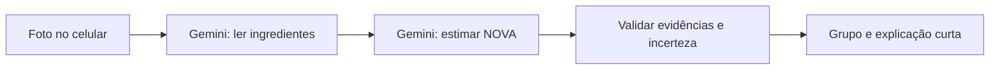

# Arquitetura simplificada

O monorepo mantém Expo/React Native/TypeScript strict, Fastify e um pacote compartilhado. O app possui somente início, captura, análise e resultado. A extração é uma operação interna, sem transcrição exposta ou correção manual. Não há persistência de dados pessoais ou acesso ao SecureStore.

`POST /api/classify` aceita uma foto JPEG/PNG base64 de até 4 MB e responde imediatamente com HTTP 202 e um identificador aleatório. O servidor lê e classifica a foto em segundo plano. O app consulta `GET /api/jobs/:id` a cada dois segundos até receber o resultado ou uma falha. Assim, o túnel não mantém uma conexão longa aguardando a IA. Resultados ficam somente na memória da instância por até dez minutos, sem histórico, e desaparecem ao reiniciar o servidor. A foto não é gravada em disco. O identificador funciona como acesso temporário ao resultado; não deve ser registrado ou compartilhado.

`POST /api/extract` e `POST /api/analyze` permanecem disponíveis para integração interna. `GET /health` e `GET /api/nova-groups` completam a API. O endpoint de chat foi removido.

A IA pode classificar formulações além do vocabulário local, desde que apresente evidência literal. Isso valida o vínculo textual, não a correção científica da inferência. Leitura incompleta, evidência inventada, abstenção do modelo e conflitos com regras conhecidas produzem indeterminado. A recomendação do Guia acompanha o grupo final, nunca uma recomendação livre do modelo.

Limites: uma foto, body de 6 MB incluindo base64, 20 inícios/minuto/IP, 120 consultas de progresso/minuto/IP, quatro operações simultâneas e 128 registros transitórios por instância. Assinaturas JPEG/PNG são verificadas, sem decodificação completa do arquivo. SDK com timeout de 55s para leitura e 25s para classificação, sem retries. A leitura solicita uma única transcrição; a lista é separada localmente para evitar texto duplicado na resposta do modelo. O cliente permite 90s para upload, 20s por consulta de progresso e até 150s para acompanhamento. O proxy admite 60s de inatividade e a API permite até 90s para receber a requisição. Não há banco remoto, histórico ou log de imagens.

Fotos são redimensionadas pelo maior lado, incluindo a altura das imagens verticais, com limite de 2000px. O app usa `XMLHttpRequest`, integrado ao React Native, para enviar JSON e receber a análise, evitando o caminho de `fetch` do Expo Go que apresentou cancelamentos no iPhone. Timeout, erro, cancelamento e resposta inválida são tratados separadamente. Não há retry automático de POST para evitar duplicar consumo da IA. Referência: [Networking do React Native](https://reactnative.dev/docs/network).

O aplicativo tem somente o fluxo com IA. Fixtures foram movidas para `tests/fixtures` e não são exportadas pelo pacote compartilhado.

Em desenvolvimento, `apps/mobile/metro.config.js` adiciona o proxy `/vera-api` para a API local em `127.0.0.1:3333`. O cliente usa `Constants.expoConfig.hostUri` para alcançar o mesmo servidor/túnel do Expo. O proxy preserva o corpo da requisição e o status da API; só encaminha as rotas previstas, incluindo início e progresso da análise, sem cookies ou credenciais do Expo. Há testes HTTP reais para essa ligação. Se a API estiver fora do ar, retorna um erro padronizado.

Em distribuição, `EXPO_PUBLIC_API_URL` deve apontar para o backend HTTPS publicado. O proxy depende do Metro e não é parte de um APK/IPA. A chave Gemini nunca é enviada ao aplicativo. Falhas de autenticação, cota, modelo, timeout e resposta inválida têm códigos distintos; o conteúdo bruto de erros do provedor não é exibido.

Diagnóstico opcional: `VERA_NETWORK_DIAGNOSTICS=1` no processo da API registra somente fase, rota, status e duração das operações. Fotos, ingredientes, chave, nomes e IPs não fazem parte desses eventos. O diagnóstico fica desativado por padrão.
